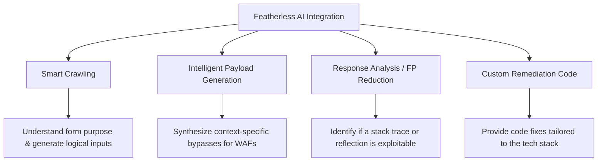

# versescan — Capabilities and Improvements

This document outlines the current security scanning capabilities of **versescan**, details how to optimize scan accuracy, discusses authenticated scanning requirements, and outlines the benefits of integrating **Featherless AI** (Serverless open-source LLM platform).

---

## 1. Scanner Accuracy & Verification Heuristics

### Does versescan have an "accuracy level"?
Currently, **versescan** does not output a generic percentage-based "accuracy score" for the target site. Instead, it computes a **Risk Score** (0 to 10) based on the severity of identified vulnerabilities. 

To ensure high accuracy and reduce false results, the scanning engine employs several **built-in verification heuristics**:

1. **Smart 404 Detection**: 
   Before fuzzing for hidden files or sensitive endpoints (e.g., `.env`, `.git/config`), the scanner sends a baseline request to a randomized bogus path. It fingerprints the server's custom "Not Found" response status and body size to distinguish true findings from custom 404 pages that return `200 OK`.
2. **Double Verification for SQL Injection (SQLi)**:
   - When a payload (like a single quote `'`) triggers a database error, the engine does not immediately report it. 
   - It performs a second "safe" request using the original input parameter. If the database error persists in the safe request, it indicates a pre-existing server error rather than a vulnerability, and the finding is discarded as a false positive.
3. **Boolean & Time-Based Verification**:
   - For Boolean-based SQLi, it compares response page lengths for `True` vs `False` conditions.
   - For Time-based Blind SQLi / Command Injection, it measures response delays (verifying if a sleep command actually delays execution by the specified duration).

---

## 2. How to Increase Scan Accuracy

To increase the detection rate (reduce false negatives) and minimize incorrect alerts (reduce false positives), the following strategies can be implemented:

* **Dynamic JavaScript Execution for XSS**:
  Instead of matching reflected substrings in HTML (which might be safely escaped or placed in safe contexts), use Playwright to monitor for actual browser events (like `page.on("dialog")` for `alert()` execution or DOM mutations).
* **Confirmative Exploit Proof of Concept (PoC)**:
  Perform safe arithmetic operations (e.g., injecting `3 * 3` or `12345 + 67890`) and check if the calculated result (e.g., `9` or `80235`) is reflected back. This proves the backend parsed and executed the injection.
* **WAF (Web Application Firewall) Fingerprinting**:
  Integrate a pre-scan WAF detection phase. If a WAF is present, the scanner should automatically slow down requests, rotate headers, and use WAF-evasion payloads to avoid getting blocked (which leads to false negatives).
* **Context-Aware XSS Injection**:
  Analyze where the parameter is reflected (e.g., inside an HTML tag, inside double-quoted attributes, single-quoted attributes, or inside a `<script>` block) and target only context-appropriate payloads.

---

## 3. Authenticated Scanning (Scanning Behind Login)

### Does a site need a login to scan the whole site's vulnerabilities?
**Yes.** If a website has an authentication wall (e.g., portals, dashboards, settings, user profiles, or billing pages), a scanner requesting those pages anonymous/unauthenticated will be blocked. The server will respond with `401 Unauthorized`, `403 Forbidden`, or redirect back to the login screen.

To scan the entire application surface, the scanner needs session credentials.

### How versescan handles authenticated scanning:
The engine provides three authentication mechanisms (configured via `auth_mode`):
1. **Interactive Login (Recommended)**: 
   Playwright opens a visible browser window. The user performs the login manually (completing MFA, Captchas, or OAuth). The user then clicks the green **"I'm Logged In"** button injected by the scanner. The engine captures the active cookies and passes them to the crawler/scanner session.
2. **Auto Login**: 
   The user provides the login URL, username, and password. The Playwright spider attempts to find login inputs, fills them in, submits the form, and captures the resulting cookies.
3. **Session Cookie Replay**: 
   The user supplies active session cookies (e.g., `[{name: "session_id", value: "xyz"}]`) via the API, which are injected into all outgoing scan requests.

---

## 4. Improvements via Featherless AI Integration

**Featherless AI** provides serverless, low-latency access to powerful open-source LLMs (like Llama 3, Qwen, and Mistral). Integrating it into **versescan** will yield major security testing improvements:

### Key Improvements:

| Feature | Legacy Scanning | With Featherless AI |
| :--- | :--- | :--- |
| **Form Filling & Crawling** | Fills forms with static text like `"test"`, failing validation on specific formats. | Understands form context (e.g., "requires a valid phone number", "needs an age > 18") and inputs realistic, valid test data. |
| **Payload Optimization** | Loops through a hardcoded list of payloads, easily caught by WAFs. | Dynamically adapts payloads based on WAF responses to find evasion paths. |
| **False Positive Filtering** | Flags any page containing database error strings. | Evaluates the entire HTTP response body and context to determine if it is a true vulnerability or a harmless error message. |
| **API Scanning** | Hard to map nested JSON parameters. | Infers API schemas and generates correctly structured JSON payloads for REST/GraphQL endpoints. |
| **Remediation & Fixes** | Displays static, generic advice (e.g., "Use parameterized queries"). | Generates precise, copy-pasteable code patches tailored to the target's exact backend language and framework (e.g., Node.js, Django, FastAPI). |
